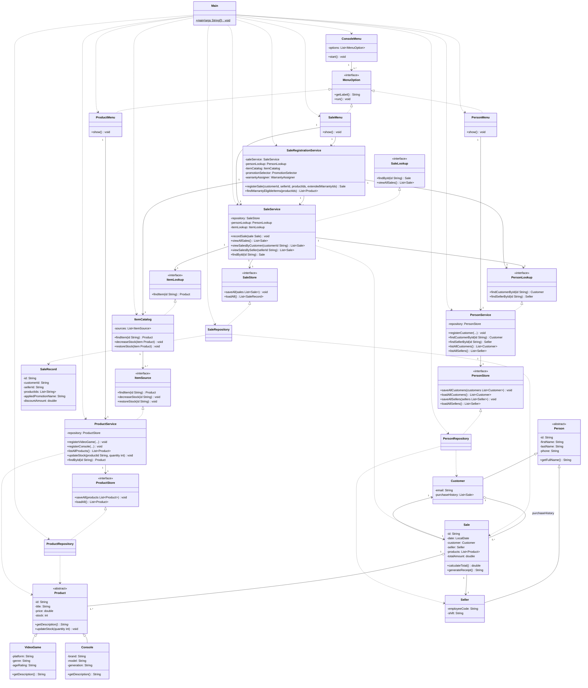

# Full Class Diagram — GameZone Unicesar

**Scope of this diagram:** the classes of Taller 1 (products, people, sales, UI and entry point) as they stand after the GRASP correction of Requerimiento 7 (v1.5.0) and the SOLID correction of Requerimiento 8 (v1.6.0), including the classes and interfaces that replaced parts of them. `ItemCatalog` also receives `AccessoryService` as an `ItemSource`; `SaleRegistrationService` also depends on `PromotionSelector` and `WarrantyAssigner`; `Sale.generateReceipt()` delegates to `SaleReceipt`; the other modules (Requerimientos 1-4) and the other five menu options are shown in [grasp-class-diagram.md](grasp-class-diagram.md) and [solid-class-diagram.md](solid-class-diagram.md).

**No layering exceptions remain.** Until v1.4.1, `SaleRepository` depended on `ProductService` and `PersonService` to resolve references while loading `data/sales.csv`, a reverse dependency that the GRASP audit classified as a Low Coupling violation (V-11). Since v1.5.0 the repository loads `SaleRecord`s that keep only ids, and `SaleService` resolves them, so persistence depends only on the model.

**Where the abstractions live.** The store interfaces (`ProductStore`, `PersonStore`, `SaleStore`, …) sit in the persistence package next to the repositories that implement them, so that services depend on persistence and never the reverse (Taller 1 layer rule). The other interfaces sit next to the clients that need them: `ItemLookup`, `ItemSource`, `PersonLookup`, `SaleLookup`, `PromotionSelector` and `WarrantyAssigner` in the service package, `MenuOption` in the UI package.
