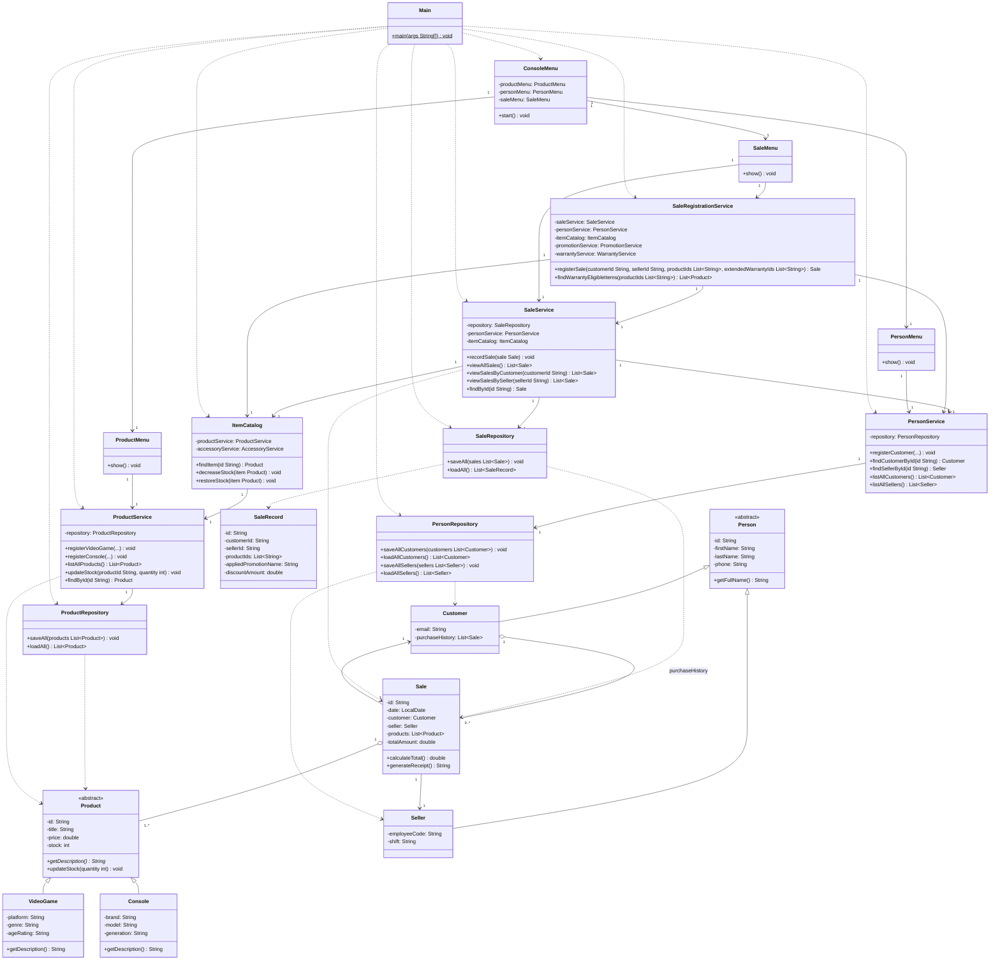

# Full Class Diagram — GameZone Unicesar

**Scope of this diagram:** the classes of Taller 1 (products, people, sales, UI and entry point) as they stand after the GRASP correction of Requerimiento 7 (v1.5.0), including the new classes that replaced parts of them (`SaleRecord`, `ItemCatalog`, `SaleRegistrationService`, and the product, person and sale submenus). `ItemCatalog` also depends on `AccessoryService`, and `SaleRegistrationService` on `PromotionService` and `WarrantyService`; those modules (Requerimientos 1-4) and the other four submenus are shown in [grasp-class-diagram.md](grasp-class-diagram.md).

**No layering exceptions remain.** Until v1.4.1, `SaleRepository` depended on `ProductService` and `PersonService` to resolve references while loading `data/sales.csv`, a reverse dependency that the GRASP audit classified as a Low Coupling violation (V-11). Since v1.5.0 the repository loads `SaleRecord`s that keep only ids, and `SaleService` resolves them, so persistence depends only on the model.
