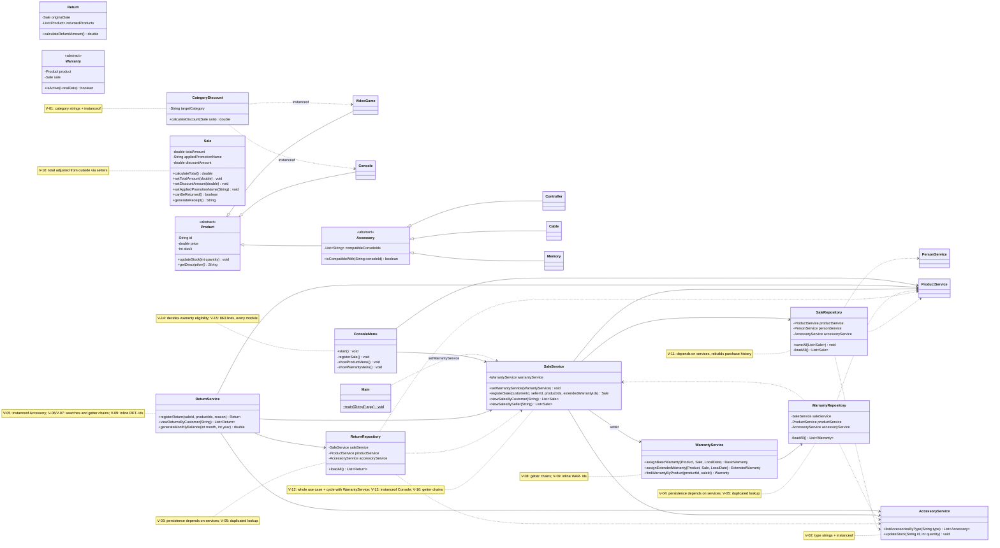
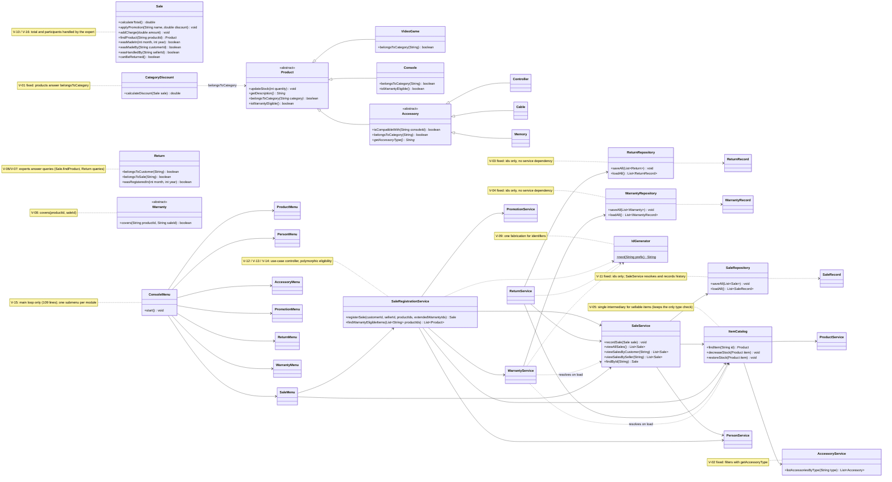

# GRASP Correction — Class Diagrams (Before and After)

Classes involved in the violations of `docs/grasp-audit/consolidated-audit.md`, with the attributes, methods and relationships relevant to them. Notes reference the violation ids (`V-XX`).

## Before (develop `7bf4931`, start of Phase 2)

## After (end of Phase 2)

New classes: `ItemCatalog`, `IdGenerator`, `SaleRegistrationService` (service); `SaleRecord`, `ReturnRecord`, `WarrantyRecord` (persistence); `ProductMenu`, `PersonMenu`, `SaleMenu`, `AccessoryMenu`, `PromotionMenu`, `ReturnMenu`, `WarrantyMenu` (ui). No persistence class depends on a service any more, and the service graph has no cycle.

