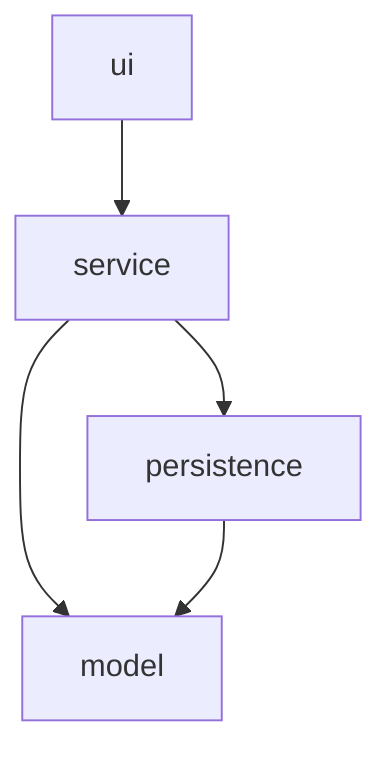

# Layer Dependency Diagram — GameZone Unicesar

Dependencies flow strictly inward, in one direction only: `ui` depends on `service`, `service` depends on both `persistence` and `model`, and `persistence` depends on `model`. The `model` layer depends on nothing else in the system. No layer may depend on a layer to its left in this diagram — for example, `model` must never depend on `persistence` or `service`, and `service` must never depend on `ui` — which keeps the domain model stable and independent while every outer layer can be extended, replaced, or tested without forcing changes on the layers it depends on.

Since v1.5.0 (GRASP correction, Requerimiento 7) the rule holds without exceptions: the sale, return and warranty repositories no longer call services to resolve references. They load records that keep only ids (`SaleRecord`, `ReturnRecord`, `WarrantyRecord`), and the services resolve those ids. `grep -r "import com.gamezone.service" src/main/java/com/gamezone/persistence` returns nothing.

Since v1.6.0 (SOLID correction, Requerimiento 8) services depend on **abstractions** of their storage (`ProductStore`, `PersonStore`, `AccessoryStore`, `PromotionStore`, `SaleStore`, `ReturnStore`, `WarrantyStore`). To keep the rule above, those interfaces live in the `persistence` package next to the repositories that implement them: the service layer depends on them, and the persistence layer never depends on the service layer.
