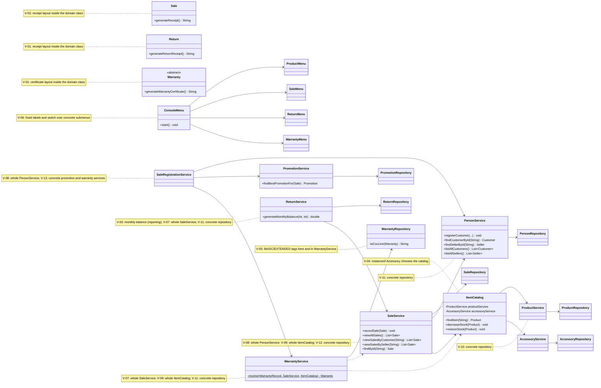

# SOLID Correction — Class Diagrams (Before and After)

Classes involved in the violations of `docs/solid-audit/consolidated-audit.md`, with the members and dependencies relevant to them. Notes reference the violation ids (`V-XX`).

## Before (develop `123ba66`, start of Phase 2)

At this point the system declares **no interfaces**: every arrow below points at a concrete class.

## After (end of Phase 2)

New types: 14 interfaces (`ProductStore`, `PersonStore`, `AccessoryStore`, `PromotionStore`, `SaleStore`, `ReturnStore`, `WarrantyStore`, `ItemLookup`, `ItemSource`, `SaleLookup`, `PersonLookup`, `PromotionSelector`, `WarrantyAssigner`, `MenuOption`) and 6 classes (`ReturnReceipt`, `WarrantyCertificate`, `SaleReceipt`, `WarrantyKind`, `MonthlyBalanceService`, `MonthlyBalanceMenu`). Services depend on abstractions for storage and for other services' read operations.

```mermaid
classDiagram
    direction LR

    class Sale {
        +generateReceipt() String
    }
    class SaleReceipt {
        +render() String
    }
    class Return {
        +generateReturnReceipt() String
    }
    class ReturnReceipt {
        +render() String
    }
    class Warranty {
        <<abstract>>
        +getKind()* WarrantyKind
        +generateWarrantyCertificate() String
    }
    class WarrantyCertificate {
        +render() String
    }
    class WarrantyKind {
        <<enumeration>>
        BASIC
        EXTENDED
        +create(id, product, sale, startDate) Warranty
    }
    Sale ..> SaleReceipt
    Return ..> ReturnReceipt
    Warranty ..> WarrantyCertificate
    Warranty ..> WarrantyKind

    class ProductStore {
        <<interface>>
    }
    class PersonStore {
        <<interface>>
    }
    class SaleStore {
        <<interface>>
    }
    class ReturnStore {
        <<interface>>
    }
    class WarrantyStore {
        <<interface>>
    }
    ProductStore <|.. ProductRepository
    PersonStore <|.. PersonRepository
    SaleStore <|.. SaleRepository
    ReturnStore <|.. ReturnRepository
    WarrantyStore <|.. WarrantyRepository

    class ItemSource {
        <<interface>>
        +findItem(String) Product
        +decreaseStock(String) void
        +restoreStock(String) void
    }
    class ItemLookup {
        <<interface>>
        +findItem(String) Product
    }
    class SaleLookup {
        <<interface>>
        +findById(String) Sale
        +viewAllSales() List~Sale~
    }
    class PersonLookup {
        <<interface>>
        +findCustomerById(String) Customer
        +findSellerById(String) Seller
    }
    class PromotionSelector {
        <<interface>>
        +findBestPromotionFor(Sale) Promotion
    }
    class WarrantyAssigner {
        <<interface>>
        +assignBasicWarranty(product, sale, date) BasicWarranty
        +assignExtendedWarranty(product, sale, date) ExtendedWarranty
    }
    ItemSource <|.. ProductService
    ItemSource <|.. AccessoryService
    ItemLookup <|.. ItemCatalog
    SaleLookup <|.. SaleService
    PersonLookup <|.. PersonService
    PromotionSelector <|.. PromotionService
    WarrantyAssigner <|.. WarrantyService

    ProductService --> ProductStore
    PersonService --> PersonStore
    SaleService --> SaleStore
    SaleService --> PersonLookup
    SaleService --> ItemLookup
    ReturnService --> ReturnStore
    ReturnService --> SaleLookup
    WarrantyService --> WarrantyStore
    WarrantyService ..> SaleLookup : resolves on load
    WarrantyService ..> ItemLookup : resolves on load
    ItemCatalog --> "1..*" ItemSource
    SaleRegistrationService --> PersonLookup
    SaleRegistrationService --> PromotionSelector
    SaleRegistrationService --> WarrantyAssigner
    SaleRegistrationService --> SaleService : recordSale
    SaleRegistrationService --> ItemCatalog : decreaseStock
    MonthlyBalanceService --> SaleLookup
    MonthlyBalanceService --> ReturnService

    class MenuOption {
        <<interface>>
        +getLabel() String
        +run() void
    }
    class ConsoleMenu {
        +start() void
    }
    ConsoleMenu --> "1..*" MenuOption
    MenuOption <|.. ProductMenu
    MenuOption <|.. SaleMenu
    MenuOption <|.. ReturnMenu
    MenuOption <|.. MonthlyBalanceMenu
    MenuOption <|.. WarrantyMenu
    MonthlyBalanceMenu --> MonthlyBalanceService

    note for ReturnReceipt "V-01: layout out of Return (and WarrantyCertificate out of Warranty)"
    note for SaleReceipt "V-02: layout out of Sale"
    note for MonthlyBalanceService "V-03: reporting out of ReturnService"
    note for ItemCatalog "V-04: asks its ItemSources, no instanceof"
    note for WarrantyKind "V-05: single list of warranty kinds"
    note for ConsoleMenu "V-06: numbers and runs the MenuOptions composed in Main"
    note for SaleLookup "V-07"
    note for PersonLookup "V-08"
    note for ItemLookup "V-09"
    note for ProductStore "V-10 / V-11 / V-12: one store per repository"
    note for PromotionSelector "V-13: owned by the sale registration use case"
```

